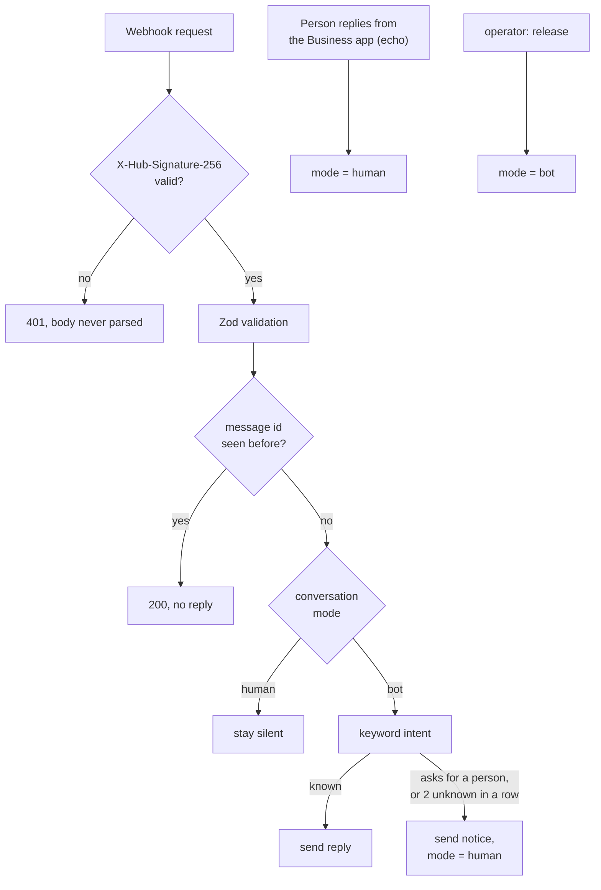

# 💬 WhatsApp Support Assistant — Bot Replies, Human Handoff

[](https://github.com/Alemarpapa/whatsapp-support-assistant/actions/workflows/ci.yml)
[](https://www.typescriptlang.org/)
[](https://vitest.dev/)
[](LICENSE)

*Versión en español: [README.es.md](README.es.md)*

A webhook server for the WhatsApp Business Cloud API. It answers simple questions (hours, location) and hands the chat to a person when the customer asks for one, when it fails to understand twice in a row, or when a person replies from the WhatsApp Business app. After a handoff the bot stays silent in that chat until an operator releases it.

> **Scope, honestly:** this is a portfolio project. It has **never been connected to a real Meta account**. Everything was tested with unit tests and a local simulator that sends signed requests shaped like the payloads in Meta's guides. Intent detection is keyword matching, not an LLM.

## 🏛️ How it works



## ✨ What it does

| Capability | Behavior |
|------------|----------|
| **Webhook verification (GET)** | Returns `hub.challenge` only when `hub.verify_token` matches; otherwise 403. |
| **Signature check (POST)** | HMAC SHA-256 of the raw body with the app secret, compared in constant time, before any parsing. Bad or missing signature: 401. Bodies over 3 MB: 413. |
| **Idempotency** | Each message id is claimed in SQLite before it is handled. A redelivered id gets no second reply, also after a restart. |
| **Send failures** | If the reply cannot be sent, the claim is released and the server answers 500, so the sender's retry is processed again. |
| **Human handoff** | The bot stops replying in that conversation. Other conversations are not affected. `npm run admin -- release <wa_id>` gives a chat back to the bot. |
| **Takeover race** | If a person takes over while a bot reply is still being sent, the bot's state save cannot overwrite `human` mode (one conditional SQL statement; covered by tests). |
| **Privacy** | Message text is never stored; logs show only the last 4 characters of a number. |
| **Outbound interface** | `WhatsAppClient` has a mock (default) and a Cloud API implementation. |

## 🚀 Quickstart (no Meta account needed)

Requires Node.js 22.9 or later.

```bash
git clone https://github.com/Alemarpapa/whatsapp-support-assistant.git
cd whatsapp-support-assistant
npm install
cp .env.example .env    # then replace the two "replace-with-..." values with any strings

npm run dev                                   # terminal 1: server in mock mode
npm run simulate -- "what are your opening hours?"     # terminal 2
npm run simulate -- "I want to talk to a person"
npm run simulate -- --echo "Hi, a person here"         # a reply sent from the Business app
npm run simulate -- --bad-signature hello
npm run admin -- list
```

Real output from a local run (server log, mock mode):

```text
webhook listening on :3977/webhook (outbound: mock)
[mock send] to …1111: We are open Monday to Friday, 9:00 to 18:00.
…1111 intent=hours -> replied
rejected webhook: bad or missing signature
[mock send] to …1111: I am handing this chat to a person from our team. They will reply here. I will stay quiet from now on.
…1111 intent=human -> handed_off (customer_request)
…2222 human replied from the Business app -> bot silenced
```

```text
$ npm run simulate -- --bad-signature hello
message id=wamid.sim-1794625339295 -> HTTP 401 Invalid signature
$ npm run admin -- list
15550002222  mode=human  reason=human_replied_from_app  updated=2026-11-14T03:02:20.775Z
15550001111  mode=bot  reason=-  updated=2026-11-14T03:02:20.345Z
```

```bash
npm run typecheck   # strict TypeScript over src/, tests/ and scripts/
npm test            # 73 Vitest tests
```

## 📱 Same number in the Business app and the API ("coexistence")

What Meta's own guides say (I only read them; I did not try any of this):

- A business that already uses the WhatsApp Business app can be onboarded to the Cloud API and keep using the app on the same number. Onboarding goes through a Solution Partner or Tech Provider using Embedded Signup, and needs app version 2.24.17 or later.
- Messages are mirrored between the app and the Cloud API. Each message sent from the app triggers an `smb_message_echoes` webhook.
- Limits listed by Meta: group chats are not synced; disappearing messages, view-once and live location are turned off; broadcast lists become read-only; the number is disconnected if the app is not opened for about 14 days; throughput is fixed at 20 messages per second.

Source: [Onboarding WhatsApp Business app users](https://developers.facebook.com/docs/whatsapp/embedded-signup/custom-flows/onboarding-business-app-users), [Set up webhooks](https://developers.facebook.com/docs/whatsapp/cloud-api/guides/set-up-webhooks), [Send messages](https://developers.facebook.com/docs/whatsapp/cloud-api/guides/send-messages).

How this project uses it: an `smb_message_echoes` event means a person answered from the app, so the bot goes silent for that chat.

## ✅ Tested vs ❌ not tested

**Tested (unit tests + local simulator):** GET handshake, signature accept/reject (including the RFC 4231 HMAC test vector), duplicate and concurrent deliveries, restart with the same database, send failure and retry, the three handoff paths, release, the takeover race, the Cloud API request shape against a stubbed `fetch`.

**Not tested against real Meta:** real signatures and real payloads, the real Graph API call (`OUTBOUND_MODE=cloud`), a real coexistence number, real `smb_message_echoes` events, Meta's retry timing. I also do not know whether messages sent through the API come back as echoes; the code ignores echoes of its own message ids in case they do.

## ⚠️ Known limits

- **At-least-once replies.** If the process dies after sending and before saving, the retry sends the same reply again.
- **A reply already in flight still goes out** when a person takes over at that exact moment; only the state is protected.
- **Two messages from one customer handled at the same instant** can both count as the first "not understood", delaying handoff by one message.
- **No rate limiting**, and stored message ids are never pruned.
- **The 24-hour customer service window is not enforced**; the bot only replies to incoming messages, which normally keeps it inside the window.
- **Users without a visible phone number** are keyed by their user id; if the same person later appears with a phone number, they count as a new conversation.
- **Keyword intents** (English and Spanish) miss anything phrased differently.

## 👤 Author
**Alejandro Martinez** — Technical Support & Implementation Engineer, AI Automation

## 📄 License
MIT
